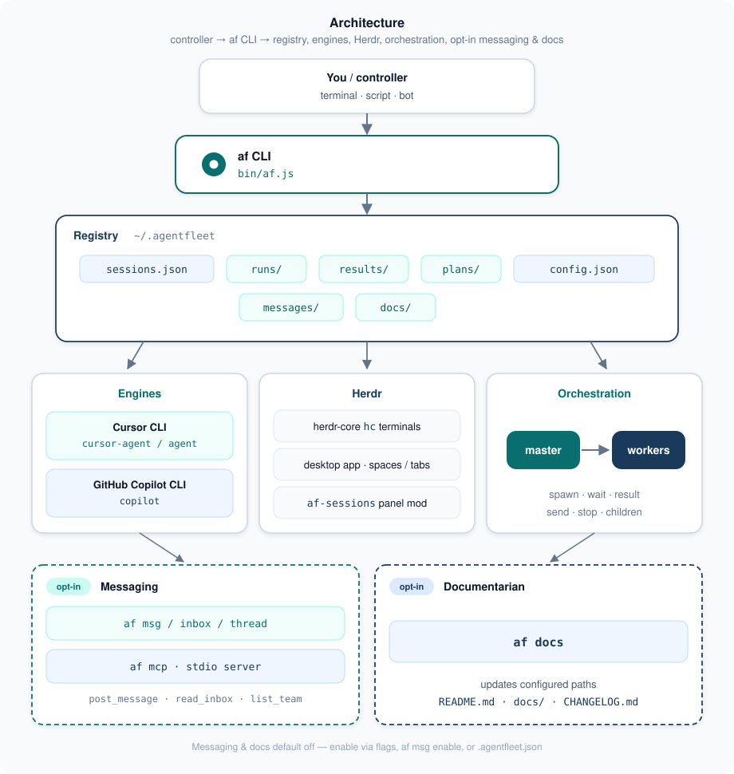
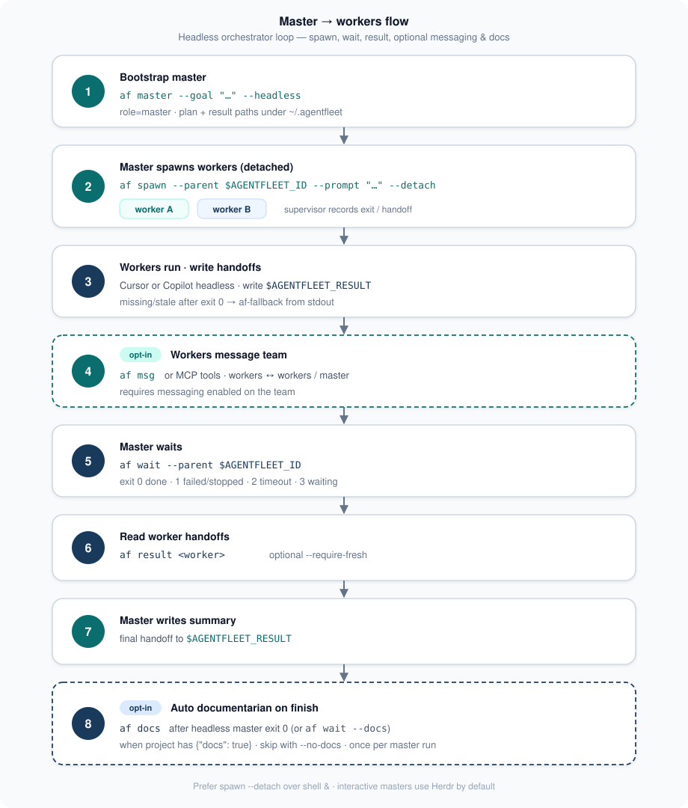

<p align="center">
  <picture>
    <source media="(prefers-color-scheme: dark)" srcset="assets/logo-dark.svg"/>
    
  </picture>
</p>

<p align="center"><strong>af</strong> / AgentFleet — track, resume, and orchestrate Cursor &amp; Copilot CLI agents</p>

<p align="center">
  =18" src="https://img.shields.io/badge/node-%3E%3D18-brightgreen?logo=node.js&logoColor=white"/>
  
  
  
  
</p>

Zero npm runtime dependencies beyond **Node ≥18**. Install once (`npm i -g .`) and you get both `agentfleet` and the short alias `af`. Engine × mode behavior (liveness, completion, handoffs, `af wait`): [docs/CAPABILITIES.md](docs/CAPABILITIES.md). Setup deep-dive: [docs/SETUP.md](docs/SETUP.md).

## Why af

CLI coding agents are powerful but ephemeral: chat IDs live in engine-local stores, terminals die on reboot, and a controller (script, bot, master agent) cannot babysit a TUI. **af** keeps a small local registry under `~/.agentfleet`, resumes the right engine argv into Herdr/tmux/iTerm/WezTerm (or plain), runs headless one-shots that capture output, and can orchestrate a **master → workers** fleet with wait/result/send/stop, optional task messaging, and an optional documentarian pass.

## Features at a glance

| Area | What you get |
|------|----------------|
| **Registry** | Atomic `sessions.json`; runs/, results/, plans/, messages/, docs/ under `$AGENTFLEET_HOME` |
| **Engines** | Cursor CLI (`cursor-agent` / `agent`) and GitHub Copilot CLI; precedence `--engine` → `AGENTFLEET_ENGINE` → `config.json` → `cursor` |
| **Modes** | Interactive TUI (Herdr by default when `hc` is on PATH) vs headless `af run` / spawn |
| **Herdr** | `hc` terminals + desktop app spaces/tabs + bundled `af-sessions` panel; shell-only reboot recovery via in-tab relaunch |
| **Orchestration** | `af master`, `af spawn [--detach]`, `children`, `wait`, `result [--require-fresh]`, `tail`, `send`, `stop`, `rm --children` |
| **Messaging** | Opt-in `af msg` / `inbox` / `thread` + stdio MCP (`af mcp`) for Copilot & Cursor |
| **Documentarian** | Opt-in `af docs`; auto once after headless master / `af wait --docs` |
| **Ops** | `af import`, `af doctor`, `--json` / `--dry-run` on mutating paths |

## Architecture

<p align="center">
  <picture>
    <source media="(prefers-color-scheme: dark)" srcset="assets/architecture-dark.svg"/>
    
  </picture>
</p>

### Master → workers flow

<p align="center">
  <picture>
    <source media="(prefers-color-scheme: dark)" srcset="assets/orchestration-dark.svg"/>
    
  </picture>
</p>

## Install

```bash
# Node 18+
cd af   # this repo
npm install -g .
# or: npm link
# or: alias af='node /path/to/af/bin/af.js'

# Cursor CLI (required for --engine cursor)
curl https://cursor.com/install -fsS | bash   # agent / cursor-agent on PATH

# Optional: Copilot CLI, Herdr (hc + herdr-app), bash completion
# npm install -g @github/copilot
source /path/to/af/completions/af.bash
```

```bash
af doctor          # read-only: node, home, hc, engines, MCP hints
af doctor --json
```

## Quick start

```bash
# Interactive tracked session (create-chat / mint UUID → register → launch)
af new "auth-refactor" --cwd ~/src/app-wt-auth --prompt "Refactor auth to JWT"

# Default engine for NEW sessions
af engine                 # print + source (flag/env/config/builtin)
af cursor                 # or: af copilot / af engine copilot

# Headless one-shot (create or resume; capture to ~/.agentfleet/runs/)
af run "auth-refactor" --prompt "Summarize the current branch" --mode ask --cwd ~/src/app-wt-auth
af log auth-refactor

# List / resume
af ls
af resume auth-refactor          # Herdr when hc on PATH; Attach: hc attach <name>
af resume                        # or af pick — TTY multi-select
af resume --all --via herdr      # fleet reopen after reboot

# Master + detached workers
af master --goal "Split auth into helpers + tests" --cwd ~/src/app --headless --force
af spawn --parent <master> --prompt "…" --detach
af wait --parent <master>
af result <worker-id>
```

---

## Sessions & registry

Home directory: **`$AGENTFLEET_HOME`** (default `~/.agentfleet`). Override registry file with **`AGENTFLEET_REGISTRY`**.

| Path | Role |
|------|------|
| `sessions.json` | Atomic registry (temp + rename; cross-process `.lock` for RMW) |
| `config.json` | Fleet defaults (`defaultEngine`) |
| `runs/<id>/` | Captured headless stdout |
| `results/` | Worker/master handoffs (`$AGENTFLEET_RESULT`) |
| `plans/` | Master plans (`$AGENTFLEET_PLAN`) |
| `messages/<masterId>.jsonl` | Team message log |
| `docs/<hash>.json` | Documentarian since-tracking |

Each session stores identity (`id`, `title`, `chatId`, `cwd`, `branch`, `model`, `engine`), lifecycle `status` (`active`\|`paused`\|`done`), `tags` / `notes` / `prompt`, optional `herdr` evidence from `af sync`, and orchestration fields (`parent`, `role`, `task`, `result`, `workerStatus`, run pid metadata, `messaging`, …).

**STATUS vs HERDR on `af ls`:** STATUS is saved lifecycle (a process exit does **not** mark the task done — use `af done`). HERDR is live runtime from `hc ls --all --json`: `running` \| `shell` \| `exited` \| `missing` \| `unknown` \| `-`. `af ls` never writes the registry; `af sync` persists `herdr` evidence without changing `status` / `lastUsed`.

## Session lifecycle commands

| Command | Purpose |
|---------|---------|
| `af new` | Create engine session → register → interactive launch |
| `af add` | Register an existing chat / Copilot UUID |
| `af ls` / `af sync` | List; persist Herdr evidence |
| `af run` / `af log` | Headless create-or-resume; print last capture |
| `af resume` / `af pick` | Resume one, interactive pick, or `--all` |
| `af rename` / `af note` / `af done` | Metadata |
| `af cwd` / `af set-cwd` | Show or change folder (refreshes branch; live tab not moved) |
| `af rm` | Drop registry row + af-owned files under `$AGENTFLEET_HOME` |
| `af export` / `af import-file` | Backup / merge registry JSON |

<details>
<summary><code>af new</code> / <code>af add</code> / <code>af resume</code> / <code>af run</code> options</summary>

- **`af new "<title>"`** — `--cwd` `--prompt` `--model` `--engine cursor|copilot` `--force` `--messaging|--no-messaging` `--tag` `--dry-run` (plus Cursor `--no-trust` where applicable)
- **`af add "<title>" --chat <id>`** — `--cwd` `--model` `--engine` `--tag` `--prompt`
- **`af run`** — `--prompt` (required) `--cwd` `--model` `--engine` `--mode ask|plan` (Cursor) `--force` `--output-format text|json` `--timeout` `--messaging|--no-messaging` `--no-docs` `--dry-run` `--json`
- **`af resume <title|id>`** — `--via herdr|plain` `--here` `--open|--no-open` `--prompt` `--force` `--dry-run` `--no-herdr-app`
- **`af resume --all`** — `--tag` `--via tmux|iterm2|wezterm|herdr|plain` `--open|--no-open` `--force` `--dry-run` `--no-herdr-app`
- **`af rm`** — `--keep-files` `--force` `--dry-run`; or `--children <master> [--with-master]`

</details>

## Engines (Cursor + Copilot)

**New-session precedence:** `--engine` → `AGENTFLEET_ENGINE` → `$AGENTFLEET_HOME/config.json` `defaultEngine` → builtin **`cursor`**. Existing sessions always keep their recorded `engine`.

```bash
af engine                  # print current default + source
af engine copilot          # persist defaultEngine
af cursor / af copilot     # aliases
```

| | Cursor | Copilot |
|---|--------|---------|
| Binary | `cursor-agent` / `agent` (`AGENTFLEET_CURSOR_BIN`) | `copilot` (`AGENTFLEET_COPILOT_BIN`) |
| Session id | `create-chat` UUID; resume `--resume` | Local UUID; `--session-id=` (create-or-resume; do not use `--resume=` for a fresh id) |
| Workspace | `--workspace` / `--trust` (default on; `--no-trust` to keep dialog) | `-C <cwd>` |
| Headless | `-p`, `--output-format`, `--mode ask|plan`, `--force` | `-p`, `--output-format`; `--force` → `--allow-all-tools` |
| Interactive `--force` | Unchanged for Cursor on `new`/`resume` | `--allow-all-tools` |
| Import | Scan `~/.cursor/chats/` | `~/.copilot/session-state/` (`AGENTFLEET_COPILOT_HOME` / `COPILOT_HOME`) |

OpenCode is a **Herdr template only** (`af herdr-templates`); not wrapped by `af run`.

## Headless vs interactive

- **Interactive** — `af new`, `af resume`, `af master` (default), `af spawn --interactive`: TUI in Herdr (default when `hc` on PATH) or this terminal (`--here` / `--via plain`).
- **Headless** — `af run`, `af spawn` (default), `af master --headless`, `af docs`: print-mode, capture to `runs/`, exit with engine code (124 on `--timeout`). Do **not** send `af run` through Herdr.

Stdout = agent output; stderr = progress + `output: <path>`. Exit **75** = critical registry write failed after a run (result still printed; `--json` includes `registryWriteError`).

## Herdr integration

Requires **herdr-core** (`hc` on PATH or `AGENTFLEET_HC_BIN`) and optionally the **Herdr desktop app**.

- **Labels:** launches add `af_id=<id>`, `title=…`, and (by default) `--keep` + `herdr.space` / `herdr.tab` so the app shows one **space per session group** (workers join the master) and one **tab per session**. Renames set Agents list titles (`space.rename` / `tab.rename`). Opt out: `--no-herdr-app` or `AGENTFLEET_HERDR_APP=0`; skip renames only: `AGENTFLEET_HERDR_NAMES=0`.
- **`af adopt`** — move already-live panes into the right space (park → label → keep when needed), then rename. App should be open to move panes.
- **`af cwd`** — updates registry folder/branch; does not move a live tab — resume (and optionally adopt) after.
- **Shell status / reboot:** `--keep` terminals restore as a login shell (`HERDR=shell`). `af resume` relaunches the engine **into the existing tab** via `hc send` (`cd '<cwd>' && env … <engine>`), without a new terminal. Prefer herdr-core ≥ 0.1.20 (`af doctor` warns when older).
- **Panel:** `af herdr-app install` symlinks (or `--copy`) `herdr/mods/af-sessions` + `herdr/layouts/af.json` into `~/.config/herdr-app` (`HERDR_APP_HOME`). Switch layout: `herdr-app do layout.switch --name af`. Panel clicks focus / adopt / resume.
- **Templates:** `af herdr-templates` installs Cursor/OpenCode/Copilot templates into `~/.config/herdr-core/templates`.
- **Backends for `resume --all`:** `tmux` | `iterm2` (macOS) | `wezterm` | `herdr` | `plain`. Auto-detect: `AGENTFLEET_VIA` → inside Herdr → tmux → `TERM_PROGRAM` → … → plain. `af which-backend` prints the choice.

## Master / worker orchestration

```bash
af master --goal "…" [--engine …] [--worker-engine …] [--headless] [--messaging] [--no-docs] …
af spawn --parent <master> --prompt "…" [--detach] [--interactive] [--engine …] …
af children [<master>] [--json] [--all]
af wait [<workers>…] [--parent <master>] [--any] [--timeout] [--interval] [--send-grace] [--docs] [--json]
af result <worker> [--path] [--json] [--require-fresh]
af tail <worker> [-n N] [-f]
af send <id> "text" [--timeout] [--force] [--json]
af stop <id> | af stop --all-children <master>
af rm --children <master> [--with-master] …
```

- **`workerStatus`:** `queued` \| `running` \| `waiting` \| `done` \| `failed` \| `stopped`
- **`af wait` exits:** `0` all done · `1` failed/stopped · `2` timeout · `3` waiting (needs input). Precedence: timeout → failed/stopped → waiting → ok. See [CAPABILITIES.md](docs/CAPABILITIES.md) for Cursor (no OSC 7501) vs Copilot interactive waiting.
- **`--detach`:** headless only; returns immediately; supervisor records exit/handoff. Prefer over shell `&`.
- **Handoffs:** workers write `$AGENTFLEET_RESULT` (default `$AGENTFLEET_HOME/results/<id>.md`). Headless success with missing/stale file → **af-fallback** from stdout. Freshness uses `runStartedAt` / `resultMtimeAtStart`; `af result --require-fresh` exits 1 if stale. HANDOFF column: `yes` / `af` / `stale` / `no`.
- **Env on launch:** `AGENTFLEET_ID` always; workers `AGENTFLEET_PARENT` / `AGENTFLEET_RESULT`; masters `AGENTFLEET_ROLE=master` / `AGENTFLEET_PLAN` / `AGENTFLEET_RESULT`. Messaging also sets `AGENTFLEET_SESSION` (= id) and `AGENTFLEET_MASTER` when known.

## Messaging

**Off by default.** Enable with `af msg enable <session>`, `--messaging` on `new`/`run`/`master`/`spawn`, or project `.agentfleet.json` `{"messaging": true}` (ancestor walk to git root). Session `messaging: false` overrides project. Messaging-enabled masters pass `messaging: true` to workers unless `--no-messaging`. Team = master; workers use `parent`. No role/parent → no team.

```bash
af msg enable auth-master
af msg master "blocked on schema" --type blocked --from auth-w1
af msg all-siblings "FYI" --from auth-w1
af msg --reply <msgId> "ack" --from auth-master
af inbox [--unread] [--mark-read] [--json]
af thread <msgId|master> [--json]
```

- **Types:** `question` \| `answer` \| `note` (default) \| `blocked`
- **Limits:** `AGENTFLEET_MSG_MAX_THREAD` (default 6), `AGENTFLEET_MSG_RATE` (default 10 / 60s)
- **MCP:** `af mcp` exposes `post_message`, `read_inbox`, `list_team` when messaging is enabled for the inherited identity.
  - **Copilot:** per-run `--additional-mcp-config` + `--allow-tool=af` (no `~/.copilot` write on launch)
  - **Cursor:** install into project/user `mcp.json`; launches get `--approve-mcps` when an `af` server is present; install writes `${env:AGENTFLEET_SESSION}` etc. for identity forwarding

```bash
af mcp install --engine copilot [--write]
af mcp install --engine cursor --project   # <cwd>/.cursor/mcp.json
af mcp install --engine cursor --write     # ~/.cursor/mcp.json
```

## Documentarian

**Off by default.** Opt in: `.agentfleet.json` `{"docs": true}`.

| Key | Meaning |
|-----|---------|
| `docs` | `true` to enable |
| `docsPaths` | default `README.md` + `docs/` (+ `CHANGELOG.md` only if it already exists) |
| `docsEngine` | `cursor` \| `copilot` |
| `docsForce` | `false` to opt out of default write grant |

```bash
af docs [<project dir>] [--since <commit>] [--engine …] [--model …]
        [--force|--no-force] [--anyway] [--dry-run] [--json]
```

- One headless worker (`role=docs`, title `docs-<folder>`, reused). Template: `templates/documentarian.md`.
- Force/write **ON by default** (Cursor `--force` / Copilot `--allow-all-tools`); opt out `--no-force` or `docsForce: false`.
- Snapshots the tree; **warns** on non-doc edits (including disallowed new `CHANGELOG.md`); does not revert.
- State: `$AGENTFLEET_HOME/docs/<hash>.json` (`lastCommit`).
- **Auto-trigger:** after successful headless master (`af master --headless` or `af run` on `role=master`) when docs enabled; skip `--no-docs`. Docs failure → WARNING + JSON `docs:{ok:false}` but master exit 0. `af wait --docs` same after wait exit 0; **errors** if no master. Guard: `docsTriggeredRunId` (once per master run). `--anyway` runs once without enabling in config.

## Import

```bash
af import                          # default engine path (cursor → ~/.cursor/chats)
af import cursor                   # always Cursor store
af import copilot                  # list ~/.copilot/session-state
af import copilot <uuid|prefix>…   # register; --title (single id), --tag, --cwd, --limit,
                                   # --json, --all, --dry-run, --allow-missing, -i|--pick
```

## Doctor, JSON, dry-run

- **`af doctor [--json]`** — read-only checks: node, home, registry, default engine, `hc`, engines, MCP wiring hints.
- **`--json`** — machine-readable stdout on supporting commands (single JSON object where applicable).
- **`--dry-run`** — plan only; no registry/state mutation (new, run, spawn, master, docs, msg enable, adopt, cwd, rm, sync, herdr-*, mcp install, …).

## Configuration

### Project: `.agentfleet.json`

```json
{
  "messaging": true,
  "docs": true,
  "docsPaths": ["README.md", "docs/"],
  "docsEngine": "cursor",
  "docsForce": false
}
```

Resolved by walking cwd → ancestors until the git root (or filesystem root).

### Fleet: `~/.agentfleet/config.json`

```json
{ "defaultEngine": "cursor" }
```

### Environment

| Variable | Purpose |
|----------|---------|
| `AGENTFLEET_HOME` | Registry dir (default `~/.agentfleet`) |
| `AGENTFLEET_REGISTRY` | Override `sessions.json` path |
| `AGENTFLEET_ENGINE` | Default engine for **new** sessions |
| `AGENTFLEET_CURSOR_BIN` | Override `cursor-agent` |
| `AGENTFLEET_COPILOT_BIN` | Override `copilot` |
| `AGENTFLEET_COPILOT_HOME` | Copilot home for import (else `COPILOT_HOME` / `~/.copilot`) |
| `AGENTFLEET_VIA` | Default `--via` / single-resume herdr vs plain |
| `AGENTFLEET_TMUX_SESSION` | tmux session name (default `agentfleet`) |
| `AGENTFLEET_HERDR_APP` | `0/false/off/no` → skip space/tab labels |
| `AGENTFLEET_HERDR_APP_BIN` | Override `herdr-app` |
| `AGENTFLEET_HC_BIN` | Override `hc` |
| `AGENTFLEET_HERDR_APP_WAIT_MS` | Max ms wait for space/rename (default 5000) |
| `AGENTFLEET_HERDR_NAMES` | `0/false/off/no` → skip rename (labels still applied) |
| `HERDR_APP_HOME` | Herdr app config dir (default `~/.config/herdr-app`) |
| `AGENTFLEET_ID` / `SESSION` / `MASTER` / `PARENT` | Set on launched sessions |
| `AGENTFLEET_RESULT` / `PLAN` / `ROLE` | Handoff / plan / role on workers & masters |
| `AGENTFLEET_SEND_GRACE` | `af wait` grace after send (default 15s) |
| `AGENTFLEET_MSG_MAX_THREAD` / `MSG_RATE` | Messaging limits (defaults 6 / 10 per 60s) |

---

## Command reference

<details>
<summary>All commands (purpose)</summary>

| Command | Purpose |
|---------|---------|
| `af new` | Create + register + interactive launch |
| `af add` | Register existing chat / Copilot UUID |
| `af import` / `af import-file` | Discover local sessions / merge backup |
| `af ls` / `af sync` | List sessions / persist Herdr evidence |
| `af run` / `af log` | Headless prompt / last capture |
| `af spawn` / `af master` | Worker under master / bootstrap orchestrator |
| `af children` | List workers or summarize masters |
| `af wait` | Block until workers terminal |
| `af result` / `af tail` | Handoff file / run log follow |
| `af send` / `af stop` | Continue chat or stop workers |
| `af docs` | Documentarian worker |
| `af msg` / `inbox` / `thread` | Task-scoped messaging |
| `af mcp` / `af mcp install` | Stdio MCP server / merge engine MCP config |
| `af resume` / `af pick` | Resume one, pick, or `--all` |
| `af adopt` | Label/move live Herdr panes into session spaces |
| `af cwd` / `af set-cwd` | Show or change session folder |
| `af cursor` / `af copilot` / `af engine` | Default engine get/set |
| `af rename` / `af done` / `af note` | Metadata |
| `af rm` | Remove session (+ af-owned files) |
| `af export` | Write registry JSON |
| `af which-backend` | Show auto-detected `resume --all` backend |
| `af herdr-templates` | Install hc templates |
| `af herdr-app install` / `status` | Install/report af-sessions panel + layout |
| `af doctor` | Read-only environment checks |
| `af help` | This usage text |

Exit codes (global): `0` ok · `1` error · `2` wait timeout · `3` waiting · `75` critical registry write after run.

</details>

<details>
<summary>Full <code>af --help</code> usage sketch</summary>

See `af --help` / `af help` for the authoritative flag list. Long-form help covers every command above including messaging MCP install paths, wait grace, docs force defaults, and the full `AGENTFLEET_*` environment block.

</details>

## More docs

- [docs/CAPABILITIES.md](docs/CAPABILITIES.md) — engine × mode capability matrix and `af wait` outcomes
- [docs/SETUP.md](docs/SETUP.md) — environment setup, Herdr, troubleshooting
- [completions/af.bash](completions/af.bash) — bash completion
- [herdr/mods/af-sessions](herdr/mods/af-sessions) — Herdr desktop panel mod (`RECIPE.md`)
- [herdr/layouts/af.json](herdr/layouts/af.json) — layout that includes the panel

## Tests

```bash
npm test
```

327 tests (Node test runner): 326 passing, 1 skipped (a live `create-chat` smoke test that only runs with a real `cursor-agent`). Coverage includes registry, engines, Herdr backends, orchestration, messaging, MCP, docs, dry-run purity, and hermetic `AGENTFLEET_HOME` fixtures.

## License

[MIT](LICENSE) © 2026 Andrew Rapo.

## Caveats

- `cursor-agent ls` is interactive-only; Cursor import scans `~/.cursor/chats/`.
- Empty chats from `create-chat` may not appear on disk until a prompt is sent.
- Resume with the **same cwd/workspace** the chat was created in.
- Primary development target is **macOS**. Linux is untested here; `tmux` / `plain` resume backends are portable, while iTerm2 / WezTerm / Herdr desktop are macOS-oriented.
- No first-class Zellij backend beyond `--via plain`.
- Cursor does not emit OSC 7501 — interactive `af wait` cannot detect turn-complete for Cursor (timeout or terminal exit).
