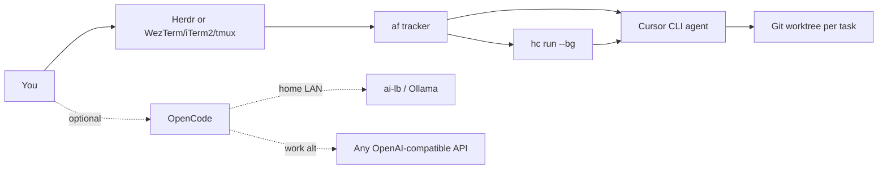

# CLI agent-fleet setup (work computer)

Self-contained guide to reproduce the home Mac mini agent-fleet stack on another macOS machine (for example a work laptop). Assumes macOS. Calls out **home-only** pieces (LAN ai-lb / ComfyUI) and gives work-friendly alternatives.

Source of truth for `af`: the code and README in this repo (`bin/af.js`, `lib/backends.js`, `lib/cursor.js`, tests). Install commands below for Herdr, Cursor CLI, OpenCode, tmux, and WezTerm were checked against their official docs (2026-11).

---

## 1. What each piece is (and how they fit)

| Piece | Role |
|-------|------|
| **Cursor CLI** (`agent` / `cursor-agent`) | Primary coding agent. Interactive TUI or headless `-p`. Sessions resume with `--resume <chatId>`. |
| **`af` (agentfleet)** | Tracks those chat sessions (title, chatId, cwd/worktree, tags, engine) in `~/.agentfleet/sessions.json`. Reopens a fleet after reboot via tmux / iTerm2 / WezTerm / Herdr / plain. Also has **`af run`** for headless one-shot prompts a controller can launch and collect. |
| **Herdr** (`hc` = herdr-core; optional desktop app) | Long-lived *interactive* agent terminals. Preferred front end when available: `af resume … --via herdr` launches `hc run --bg …`. Not used for `af run` print-mode. |
| **OpenCode** (optional) | Cheap / local-friendly coding agent. At home it pointed at the LAN **ai-lb** OpenAI-compatible proxy. On a work machine, point it at any OpenAI-compatible endpoint you are allowed to use — or skip it. `af` does not wrap OpenCode headless; a Herdr template is provided for interactive use. |
| **GitHub Copilot CLI** (optional) | Separate coding agent (`copilot`, also reachable as `gh copilot`). `af run --engine copilot` can drive its documented `-p` mode. This is **not** `gh` repo tooling and **not** `gh agent-task`. |
| **tmux / WezTerm / iTerm2** | Terminal backends for `af resume --all` when Herdr is not the front end. tmux is best for headless/SSH; WezTerm or iTerm2 for a GUI Mac. |
| **Git worktree per task** | One cwd (worktree) per agent session so agents do not stomp each other's files. `af` records that cwd and always resumes with `--workspace`. |

Recommended division of labor (same as the home workflow):

- **Herdr** — front end / process host for agent terminals (when installed).
- **Cursor CLI** — hard coding work (uses your Cursor allowance).
- **OpenCode** — optional cheap/local runs (home: ai-lb; work: other endpoint or skip).
- **tmux** — headless or remote recovery when you are not in Herdr.
- **One git worktree per task** — always.



---

## 2. Prerequisites

- **macOS** (Intel or Apple Silicon).
- **Node.js ≥ 18** (required by `af`; Cursor CLI is also a Node binary).
- Ability to write under your home directory (`~/.local`, `~/.config`, `~/.agentfleet`). Admin/`sudo` is **not** required for the user-local install path used below.
- A Cursor account (for `agent login`), unless you use `CURSOR_API_KEY` instead.
- Git (for worktrees).
- Network access to the install URLs (or a pre-downloaded archive of this repo).

**Home-only (do not expect these on a work machine):**

| Resource | Home example | Work alternative |
|----------|--------------|------------------|
| ai-lb OpenAI-compatible proxy | `http://192.168.10.101:11435/v1` (e.g. `gemma4:12b-16k`) | Point OpenCode at any allowed OpenAI-compatible `…/v1` endpoint, use `/connect` for a cloud provider, or **skip OpenCode** |
| ComfyUI | `192.168.10.102:8188` | Not part of this fleet stack; omit |
| Herdr desktop Cursor/OpenCode *app* integrations | Desktop app is installed on the home Mini (`~/Applications/Herdr.app`) but `~/.config/herdr-app` was absent as of 2026-11-10; no GUI recipes to finish from the CLI | Use `hc` templates (`af herdr-templates`) + `af resume --via herdr` + raw CLIs; see §3.6 and §8 |

---

## 3. Install steps (in order)

Prefer user-local installs. On a locked-down Mac without Homebrew in `/opt/homebrew` or `/usr/local`, install Homebrew into your home prefix if policy allows, or install Node via nvm/fnm and skip casks you cannot install.

### 3.1 PATH baseline

Add these early so later installers and CLIs resolve:

```bash
# zsh (default on modern macOS) — put in ~/.zshrc (and ~/.zprofile for login shells if needed)
export PATH="$HOME/.local/bin:/opt/homebrew/bin:/usr/local/bin:$PATH"
```

Reload: `source ~/.zshrc`

### 3.2 Homebrew + Node (if missing)

```bash
# Official Homebrew installer (asks for password when installing Apple CLT / system paths)
 /bin/bash -c "$(curl -fsSL https://raw.githubusercontent.com/Homebrew/install/HEAD/install.sh)"

# Then follow the "Next steps" it prints to add brew to PATH, e.g. Apple Silicon:
# eval "$(/opt/homebrew/bin/brew shellenv)"

brew install node    # Node ≥ 18
node -v
```

Without admin/Homebrew: use [nvm](https://github.com/nvm-sh/nvm) or [fnm](https://github.com/Schniz/fnm) to install Node into `~`.

### 3.3 tmux

```bash
brew install tmux
tmux -V
```

### 3.4 WezTerm or iTerm2 (pick one GUI terminal)

```bash
# WezTerm (af has a first-class --via wezterm backend)
brew install --cask wezterm

# or iTerm2 (af --via iterm2 uses osascript)
brew install --cask iterm2
```

You can use the stock Terminal.app and rely on `af … --via tmux` or `--via plain` instead.

### 3.5 Cursor CLI + login

Official install ([cursor.com/docs/cli/installation](https://cursor.com/docs/cli/installation)):

```bash
curl https://cursor.com/install -fsS | bash

# Ensure ~/.local/bin is on PATH (installer places agent + cursor-agent there)
agent --version
# cursor-agent is the same binary (legacy name); af prefers cursor-agent then agent
which cursor-agent || which agent
```

Authenticate:

```bash
agent login
agent status
```

Headless / scripted usage (from [CLI parameters](https://cursor.com/docs/cli/reference/parameters)):

```bash
# Print mode: non-interactive answer to stdout
agent -p "Summarize this repo's README" --output-format text

# --force / --yolo: only for runs that must edit / run shell without prompts
agent -p "Apply the fix in src/foo.ts" --force --output-format text
```

**Convention used at home:** use `--force` only on editing runs; omit it for read-only / ask-style prompts.

Create / resume chats (what `af` wraps):

```bash
agent create-chat          # prints a UUID
agent --resume <chatId> --workspace /path/to/worktree
```

### 3.6 Herdr (core CLI + optional app)

**Core only** (`hc`) — enough for `af --via herdr` ([herdr-core README](https://github.com/herdrdev/herdr-core)):

```bash
curl -fsSL https://releases.herdr.dev/core/install.sh | sh
hc --help
hc update   # later updates; running terminals keep running
```

**Desktop app** (installs/updates core if missing) — [herdr.dev/download](https://herdr.dev/download/):

```bash
curl -fsSL https://releases.herdr.dev/app/install.sh | sh
# macOS app typically lands in ~/Applications/Herdr.app
# Apple Silicon also: brew install --cask herdr-app
```

Config file (created/used by core): `~/.config/herdr-core/config.toml`  
(Windows would use `%APPDATA%\herdr-core\config.toml`; this guide is macOS-focused.)

Minimal example from upstream docs (optional shell override):

```toml
# ~/.config/herdr-core/config.toml
# shell = ["zsh", "-l"]
```

Smoke test (this exact form was verified on the home Mini, herdr-core **0.1.16**, 2026-11-10):

```bash
hc run --bg --no-parent --outlive-parent --name af-smoke --cwd /tmp --label af_id=smoke -- echo hello
hc ls --json
hc read af-smoke
hc kill af-smoke; hc rm af-smoke   # if it has already exited, just hc rm
```

**`--` separator: do not use it.** On hc 0.1.16, `hc run … -- echo hello` fails with `spawn_failed` / `cannot start "--": No such file or directory`. `af` therefore does **not** emit `--` (see `lib/backends.js` `buildHerdrCommands`). The program name must come immediately after the flags.

**Cursor / OpenCode integrations, as of 2026-11-10 on the home Mini:**

- `hc` 0.1.16 at `~/.local/bin/hc`; Herdr.app at `~/Applications/Herdr.app` (also `~/.local/bin/herdr-app`).
- `hc templates` was empty; `~/.config/herdr-core` did not exist; `~/.config/herdr-app` did not exist. The desktop app's agent-menu integrations were not configured, and finishing those in the GUI needs the Herdr desktop (not available to a CLI-only agent).
- CLI path that *is* finished: `af herdr-templates` installs bundled `cursor.md` and `opencode.md` into `~/.config/herdr-core/templates/` (official format from [templates.md](https://github.com/herdrdev/herdr-core/blob/master/docs/templates.md): `command`, `description`, `ready: quiet`). Then:

```bash
hc templates
hc run --bg --name review --cwd /path/to/worktree cursor "Review src/foo.ts only. Read-only."
hc read review --lines 100
```

`ready: quiet` is used because Cursor CLI and OpenCode do not implement Herdr's OSC 7501 status protocol, so the default "wait for a status report" readiness would often fail to send the first message. If the first message is still delayed, `hc read` then `hc send`.

`af resume --via herdr` still does **not** need templates — it shells out to `hc run` with `cursor-agent --resume …` directly.

Home Mini ran **hc 0.1.16**; current upstream may be newer — `hc update` is fine, but re-check `hc run` if you upgrade (especially the `--` behavior).

### 3.7 OpenCode (optional)

Current official install ([opencode.ai](https://opencode.ai/docs/), [terminal page](https://opencode.ai/terminal)):

```bash
# Pick one
curl -fsSL https://opencode.ai/v2/install | bash
# or: brew install anomalyco/tap/opencode-v2
# or: npm install -g @opencode/cli

opencode --version
```

**Home setup note:** the home Mini used OpenCode **1.19.5** pointed at ai-lb. Current docs describe OpenCode **v2** and `opencode.json` / `opencode.jsonc`. Prefer the current installer on a new machine; do not assume 1.x config files still apply.

**Work alternatives (no home LAN):**

1. Skip OpenCode entirely and use Cursor CLI only.
2. `/connect` inside OpenCode to a cloud provider you are allowed to use.
3. Custom OpenAI-compatible provider in `~/.config/opencode/opencode.json` (or project `opencode.json`), per [Providers](https://opencode.ai/docs/providers/):

```jsonc
{
  "$schema": "https://opencode.ai/config.json",
  "model": "workgate/coder",
  "providers": {
    "workgate": {
      "name": "Work gateway",
      "env": ["WORK_GATEWAY_API_KEY"],
      "package": "@opencode/ai/providers/openai-compatible",
      "settings": {
        "baseURL": "https://llm.example.com/v1"
      },
      "models": {
        "coder": { "name": "Coder" }
      }
    }
  }
}
```

Put the API key in the environment (`export WORK_GATEWAY_API_KEY=…`), not in a git repo.

**Home-only ai-lb sketch** (only if VPN/LAN reaches the box — not expected at work):

```jsonc
{
  "$schema": "https://opencode.ai/config.json",
  "providers": {
    "ailb": {
      "name": "ai-lb",
      "package": "@opencode/ai/providers/openai-compatible",
      "settings": { "baseURL": "http://192.168.10.101:11435/v1" },
      "models": { "gemma4:12b-16k": { "name": "gemma4 12b" } }
    }
  }
}
```

(Exact 1.x vs 2.x field names may differ; verify against `opencode` docs for your installed version.)

### 3.8 Install `af` from this archive

Copy `agentfleet/` (or extract `agentfleet.tar.gz`) onto the work machine, then:

Preferred user-local layout (used on the home Mini; avoids writing under `/usr/local`):

```bash
# after copying this tree (or extracting agentfleet.tar.gz)
mkdir -p "$HOME/.local/share" "$HOME/.local/bin"
# install tree: ~/.local/share/agentfleet
cp -R /path/to/agentfleet "$HOME/.local/share/agentfleet"
ln -sfn "$HOME/.local/share/agentfleet/bin/af.js" "$HOME/.local/bin/af"
ln -sfn "$HOME/.local/share/agentfleet/bin/af.js" "$HOME/.local/bin/agentfleet"

export PATH="$HOME/.local/bin:$PATH"
af help
cd "$HOME/.local/share/agentfleet" && npm test
af herdr-templates    # optional; skips files that already exist
```

Alternatives: `npm install -g --prefix "$HOME/.local" .` (creates `~/.local/lib`), `npm link`, or `alias af='node /path/to/agentfleet/bin/af.js'`. Avoid `npm install -g .` into `/usr/local` unless you intend to write there.

Optional bash completion:

```bash
source /path/to/agentfleet/completions/af.bash
```

Override binary if needed:

```bash
export AGENTFLEET_CURSOR_BIN="$HOME/.local/bin/cursor-agent"
```

---

## 4. Configuration cheat sheet

| Variable / path | Purpose |
|-----------------|---------|
| `~/.agentfleet/sessions.json` | Session registry (atomic write). Mode `0600`. |
| `AGENTFLEET_HOME` | Override registry directory. |
| `AGENTFLEET_REGISTRY` | Override full path to `sessions.json`. |
| `AGENTFLEET_CURSOR_BIN` | Force path to `cursor-agent` / `agent`. |
| `AGENTFLEET_VIA` | Default `--via` backend. |
| `AGENTFLEET_TMUX_SESSION` | tmux session name (default `agentfleet`). |
| `AGENTFLEET_HERDR_APP` | Set `0` / `false` / `off` / `no` to skip Herdr-app space/tab labels. |
| `AGENTFLEET_HERDR_APP_BIN` | Override `herdr-app` binary path. |
| `~/.config/herdr-core/config.toml` | herdr-core settings. |
| `~/.config/opencode/opencode.json` | OpenCode global config (v2). |
| `CURSOR_API_KEY` | Headless Cursor auth alternative to `agent login`. |
| `AGENTFLEET_COPILOT_BIN` | Force path to `copilot`. |
| `PATH` | Must include `~/.local/bin` (and Homebrew). |
| `~/.config/herdr-core/templates/*.md` | `hc` agent templates (`af herdr-templates`). |
| `~/.agentfleet/runs/<id>/` | Captured `af run` output (mode `0600`). |

Backend auto-detect order in `af` (`lib/backends.js`):  
`$AGENTFLEET_VIA` → inside Herdr (`HERDR` / `HC_TERMINAL` / … and `hc` on PATH) → inside tmux → `TERM_PROGRAM` WezTerm / iTerm → `tmux` on PATH → `wezterm` → `plain`.

Check what your shell would pick:

```bash
af which-backend
```

---

## 5. Daily workflow

### 5.1 New task → worktree → tracked agent

```bash
# From the main clone
REPO=~/src/myapp
TASK=auth-refactor
git -C "$REPO" fetch
git -C "$REPO" worktree add -b "feat/${TASK}" "$REPO-wt-${TASK}" origin/main
# (branch base name is up to you; keep one worktree directory per agent)

cd "$REPO-wt-${TASK}"

# Create chat, register, and drop into interactive resume
af new "$TASK" --cwd "$PWD" --prompt "Refactor auth to JWT" --model gpt-5
```

Register an existing chat instead:

```bash
af add "$TASK" --chat aaaaaaaa-bbbb-cccc-dddd-eeeeeeeeeeee --cwd "$REPO-wt-${TASK}"
```

List / annotate:

```bash
af ls                         # STATUS = lifecycle; HERDR = running|exited|missing|unknown|-
af ls --json
af sync --dry-run             # preview Herdr runtime that would be persisted
af sync                       # persist herdr evidence only (not status / lastUsed)
af note "$TASK" "dev server: npm run dev on :5173"
```

**STATUS vs HERDR:** `STATUS` is the saved task lifecycle (`active`/`paused`/`done`). A Herdr process exiting does **not** mean the task is done — mark that with `af done`. `HERDR` is live runtime from `hc ls --all --json` (matched only by label `af_id=<session.id>`). Sessions never launched via Herdr show `-`, not `missing`. Default `hc ls` hides finished terminals; `hc ls --all` is required so finished shows as `exited`. Attach with `~/.local/bin/hc attach <name>`.

### 5.2 Headless run (controller / Grok Bot)

Use this when another agent or a script should offload a task to Cursor (or Copilot), wait, and read the result — no TUI, no Herdr attach.

```bash
# Cheap read-only (Cursor --mode ask). --force is omitted on purpose.
af run "smoke-ask" --prompt "Reply with the single word pong and nothing else." --mode ask --cwd /tmp

# Plan only (still read-only)
af run "smoke-ask" --prompt "Outline how you would add a --json flag." --mode plan --cwd "$PWD"

# Editing run — only when you intend the agent to change files / run tools
af run "fix-tests" --prompt "Fix the failing unit tests." --force --cwd "$REPO-wt-${TASK}"

# Bound the wait
af run "smoke-ask" --prompt "…" --mode ask --cwd "$PWD" --timeout 180

# Collected output
af log smoke-ask
af log smoke-ask --path     # ~/.agentfleet/runs/<id>/<timestamp>.cursor.txt
```

Stdout is the print-mode response. Stderr has progress plus `output: <path>`.

**Cursor `--trust` default (caller-controlled):** `af run` and `af resume` (including `--via herdr`) pass `--trust` unless you pass `--no-trust`. That only skips Cursor's "Workspace Trust Required" dialog in a registered cwd. It is visible in `--dry-run` and is **not** `--force` (it does not auto-approve tools or shell). A Mini smoke on 2026-11-10 hit that dialog before this default was added. Use `--no-trust` if you want the prompt.

**Copilot:** `--help` claims `--allow-all-tools` is required for `-p`, but a no-tool "reply pong" prompt succeeded without it (CLI 1.0.83, Mini, 2026-11-10). `af run --engine copilot` therefore does **not** add `--allow-all-tools` unless you pass `--force`. `--force` is an explicit grant (not `--allow-all` / `--yolo`). For a text-only prompt, omit `--force`.

```bash
af run "copilot-probe" --engine copilot --prompt "Reply pong." --cwd "$PWD" --dry-run
af run "copilot-probe" --engine copilot --prompt "Reply pong." --cwd "$PWD" --timeout 90
# only if you intend auto-approved tools in that cwd:
af run "copilot-probe" --engine copilot --prompt "…" --cwd "$PWD" --force
```

`gh` itself (`gh pr`, `gh issue`, `gh api`, …) stays a separate CLI. `af` will not run it, will not commit or push, and will not create `gh agent-task` cloud jobs. Use `gh` directly when you want repo operations, with the usual approval rules.

Do not combine `af run` with `--via herdr`. Long-lived interactive sessions use §5.3.

### 5.3 Launch / resume via Herdr

```bash
# One session into Herdr (default when hc is on PATH; skips if already live)
af resume "$TASK"
af resume "$TASK" --via herdr             # same
af resume "$TASK" --dry-run               # print hc command + Attach line
af resume "$TASK" --here                  # Cursor TUI in this terminal
af resume "$TASK" --open                  # also open an iTerm2 tab: hc attach <name>
af resume                                 # TTY picker (or: af resume -i / af pick)

# Entire active fleet
af resume --all --via herdr
af resume --all --via herdr --dry-run
```

What `af` builds (from `buildHerdrCommands`):

```text
hc run --bg --no-parent --outlive-parent \
  --name <sanitized-title> \
  --cwd <workdir> \
  --label af_id=<session-id> \
  --label title=<title> \
  --keep \
  --label herdr.space=sp<md5hex> \
  --label herdr.tab=tb<md5hex> \
  env -u NO_COLOR -u FORCE_COLOR [TERM=xterm-256color COLORTERM=truecolor] \
  cursor-agent --resume <chatId> [--model …] --workspace <cwd> --trust
```

(`TERM`/`COLORTERM` assignments are added only when the caller's `TERM` is unset, empty, or `dumb`, so non-TTY af launches still get a color-capable Cursor TUI.)

Names are lowercased, sanitized to `[a-z0-9_-]`, truncated to 32 chars, and de-duplicated. Sessions already present in `hc ls --json` with matching `af_id` are skipped. Resume restores chat context via `--resume <chatId>` and does **not** resend the saved original task prompt (a prompt is sent only on `af new --prompt` or an explicit `--prompt` on that resume).

#### Herdr app (desktop)

The Herdr desktop app shows any core terminal labeled `herdr.space=<id>` and `herdr.tab=<id>` (unknown ids become a new space/tab). `af` derives:

- `herdr.space` = `sp` + md5(`agentfleet:space:` + normalized cwd) — sessions in the same repo/cwd share a space
- `herdr.tab` = `tb` + md5(`agentfleet:tab:` + session.id) — one tab per af session; stable across resumes

On Herdr launch, `af` also passes `--keep` (lost program → shell; Cursor is **not** re-run — use `af resume` again) and best-effort renames the tab to the af title via `herdr-app do tab.rename` (retries ~0.5–3s; never fails the resume). Opt out with `--no-herdr-app` or `AGENTFLEET_HERDR_APP=0|false|off|no`. Override the binary with `AGENTFLEET_HERDR_APP_BIN` (default: `herdr-app` on PATH, typically `~/.local/bin/herdr-app`).

Adopt terminals that were started before this labeling existed:

```bash
af adopt --all                 # or: af adopt <title|id …>
af adopt --all --dry-run
```

That runs `hc label <addr> herdr.space=… herdr.tab=…` and `hc keep <addr>`, then tries tab rename. Cursor does not report OSC 7501, so the app's Agents panel stays empty for these sessions.

List / attach:

```bash
hc ls              # live only (finished are hidden)
hc ls --all --json # includes finished (what af ls / af sync query)
~/.local/bin/hc attach <name>
herdr-app ls       # desktop spaces/tabs (when the app window is running)
```

`af resume` / `af resume --via herdr` (and `--dry-run`) prints a copy-pasteable `Attach: hc attach <name>` for each launched or already-live skipped session. In an iTerm2 TTY, a new tab running the attach command (absolute `~/.local/bin/hc` path) opens by default; `--no-open` prints the line only. `--all` still auto-detects its backend and does not default to Herdr just because `hc` is on PATH.

`af ls` shows a HERDR column from that `--all` query without writing the registry. `af sync` persists last-known `herdr` evidence (runtime/address/exit) and does **not** overwrite `status` or `lastUsed`. Process exit ≠ task done.

### 5.4 Launch / resume via tmux / WezTerm / iTerm2 / plain

```bash
af resume --all --via tmux
tmux attach -t agentfleet

af resume --all --via wezterm
af resume --all --via iterm2
af resume --all --via plain          # print commands only
af resume --all --dry-run
af resume "$TASK" --here             # this terminal; sets OSC tab title
```

### 5.5 Track → finish → cleanup

```bash
af ls
af rename "$TASK" "auth-jwt-done"
af done "$TASK"          # status=done (hidden from default ls)
af ls --all              # include done
af export ~/backup-af-sessions.json
af rm "$TASK"            # remove registry row only (does not delete the Cursor chat or worktree)

# When finished with the worktree itself (your git hygiene — af does not delete trees)
git -C "$REPO" worktree remove "$REPO-wt-${TASK}"
```

### 5.6 Headless Cursor (without af)

```bash
export PATH="$HOME/.local/bin:/opt/homebrew/bin:$PATH"
cursor-agent -p "Run unit tests and summarize failures" --output-format text
# editing run:
cursor-agent -p "Fix the failing test" --force --output-format text --workspace "$PWD"
```

---

## 6. Reboot / recovery

1. Boot, open Herdr **or** your terminal multiplexer.
2. Ensure PATH includes `~/.local/bin`.
3. `af ls` — confirm active sessions and that worktree paths still exist.
4. Reopen the fleet:

```bash
af resume --all --via herdr     # preferred if hc works
# or
af resume --all                 # auto-detect
# or
af resume --all --via tmux
```

**Important (from README):** resume restores **chat context** via `--resume <chatId>` and does **not** resend the saved original task prompt. It also does not restart in-flight shells, servers, or watchers — restart those yourself (or keep them in `af note`).

Backup / migrate registry between machines:

```bash
af export ~/af-sessions.json
# on the other Mac, after paths exist:
af import-file ~/af-sessions.json
```

---

## 7. Work-computer caveats

- **Corporate policy:** confirm that Cursor CLI, Herdr, OpenCode, and Homebrew/casks are allowed. Prefer user-local installs under `~`.
- **No secrets in repos:** never commit API keys, `CURSOR_API_KEY`, gateway tokens, or `~/.agentfleet` dumps that contain prompts you would not share. Use env vars or the OS keychain.
- **Separate Cursor accounts:** `agent login` / `agent status` — use the work account on the work machine; do not copy home auth blobs.
- **No home LAN:** skip ai-lb and ComfyUI; OpenCode is optional.
- **VPN:** if work VPN blocks `releases.herdr.dev` / `cursor.com` / `opencode.ai`, download installers on an allowed network and transfer the archive.
- **Git worktrees on corporate repos:** follow your team's branch naming and do not force-push shared branches.
- **Do not** commit, push, reset, or delete files in shared repos without explicit approval from the repo owner.

---

## 8. Troubleshooting

| Symptom | What to try |
|---------|-------------|
| `cursor-agent: command not found` | `ls ~/.local/bin/agent`; add `~/.local/bin` to PATH; re-run Cursor install. |
| `hc: command not found` | Re-run core or app installer; check `~/.local/bin/hc`. |
| `af resume --via herdr` / `cannot start "--"` | Confirmed on hc 0.1.16: do **not** put `--` before the program. Current `af` already omits it. If an older copy still emits `--`, update `lib/backends.js`. |
| Cursor TUI is plain white / uncolored in Herdr | Herdr/parent may set `NO_COLOR=1` and `FORCE_COLOR=0`; non-TTY callers may also pass `TERM=dumb`. `af` clears the color vars with `env -u NO_COLOR -u FORCE_COLOR` and, when `TERM` is unset/empty/`dumb`, sets `TERM=xterm-256color` `COLORTERM=truecolor` before `cursor-agent`. |
| Herdr skips a session | `hc ls --json` already has `af_id=<id>`. Attach that terminal or kill it before re-launching. |
| Resume lost context / wrong files | Always use the **same cwd/worktree** the chat was created with. `af` passes `--workspace`. |
| Resume re-triggers the original task | Older `af` fell back to `session.prompt` on resume. Current `af` does not; only `af new --prompt` or an explicit resume `--prompt` sends a prompt. |
| `af import` empty | `cursor-agent ls` is interactive-only; import scans `~/.cursor/chats/`. Empty chats from `create-chat` may not appear until a prompt is sent — use `af new` or `af add --chat`. |
| iTerm2 backend fails | Needs macOS + iTerm2 + `osascript`. Use `--via tmux` or `--via wezterm` instead. |
| OpenCode cannot reach ai-lb | Expected off-LAN. Reconfigure provider or skip OpenCode. |
| Tests fail without Cursor CLI | Unit tests still pass with a stub; the optional live `create-chat` test needs a real binary + auth. |
| Desktop Herdr has no Cursor/OpenCode recipe | App integrations need the Herdr GUI (not configured on the home Mini as of 2026-11-10). CLI alternative: `af herdr-templates` then `hc run cursor "…"` / `hc run opencode "…"`, or `af resume --via herdr`. |
| Copilot tool prompts / hangs in `-p` | A no-tool text prompt does not need `--force`. `--force` adds `--allow-all-tools`. Auth is `copilot login`; there is no `copilot status`. |
| `af run` / Herdr resume hangs on "Workspace Trust Required" | Default is `--trust` (documented; shown in `--dry-run`). Pass `--no-trust` to keep the dialog and accept it in the TUI or `hc keys`. `--trust` is not `--force`. |

Useful dry-runs:

```bash
af new "probe" --cwd "$PWD" --dry-run
af resume --all --via herdr --dry-run
af resume --all --via tmux --dry-run
af which-backend
```

---

## 9. Supported vs verified (home Mini, 2026-11-10, America/New_York)

| Path | Status |
|------|--------|
| Cursor `af run` headless (`-p`, `--mode ask`) + `af log` | **Verified** live (reply "pong", exit 0) |
| Cursor `af resume --via herdr` | **Verified** live. hc 0.1.16 **rejects** a `--` separator (`cannot start "--"`); current `af` omits it. Default `--trust` required to clear the workspace-trust dialog. |
| Copilot `copilot -p` / `af run --engine copilot` **without** `--force` | **Verified** live no-tool "pong" (CLI 1.0.83). Auth confirmed by that CLI result; credential files were not read. `--help` overstated the need for `--allow-all-tools`. |
| Copilot `--force` (`--allow-all-tools`) | Supported by `af`; **not** live-tested (broad tool grant). `af` never adds `--allow-all` / `--yolo`. |
| OpenCode | **Template only** (`af herdr-templates` → `hc run opencode "…"`). Not wrapped by `af run`. First-message send not live-tested. |
| Herdr desktop Cursor/OpenCode integrations | **Unconfigured**. Herdr.app is present; `~/.config/herdr-app` is absent. Needs the GUI. |
| Reboot persistence | **Not tested** (Mini was not rebooted). |
| `cursor-agent persist` | Exists (`list` / `attach` / `stop`); not wrapped by `af`. |
| `gh` repo tooling / `gh agent-task` | Installed/authenticated separately; **not** wrapped by `af`. |

Other notes: bundled Herdr templates use official frontmatter and `ready: quiet`. OpenCode on this Mini is still 1.19.5 + ai-lb; a new-machine install should follow current OpenCode docs. Local Cursor chat store layout `~/.cursor/chats/<md5(cwd)>/<chatId>/` remains community-observed.

---

## 10. Quick checklist (work Mac)

- [ ] PATH has `~/.local/bin` (+ Homebrew)
- [ ] Node ≥ 18
- [ ] `tmux` installed
- [ ] WezTerm or iTerm2 (optional but nice)
- [ ] `agent` / `cursor-agent` installed and `agent login` OK
- [ ] `hc` installed; optional Herdr.app
- [ ] OpenCode installed **or** consciously skipped
- [ ] `af` installed on PATH (`~/.local/bin/af`); `npm test` green
- [ ] `af help` shows `run`, `log`, `sync`, `herdr-templates`
- [ ] `af ls` shows HERDR; `af sync --dry-run` does not write
- [ ] `af run "smoke" --prompt "Reply pong." --mode ask --cwd … --dry-run` looks right; then a cheap live ask if you want to spend Cursor quota
- [ ] `af resume smoke --via herdr --dry-run` has **no** `--` before `cursor-agent`; then without `--dry-run` if you want a live TUI
- [ ] `af herdr-templates` && `hc templates` lists `cursor` and `opencode`
- [ ] `af export` backup stored outside the repo

When in doubt, lean on Cursor CLI + `af` + tmux; treat Herdr as the nicer front end and OpenCode as optional.
